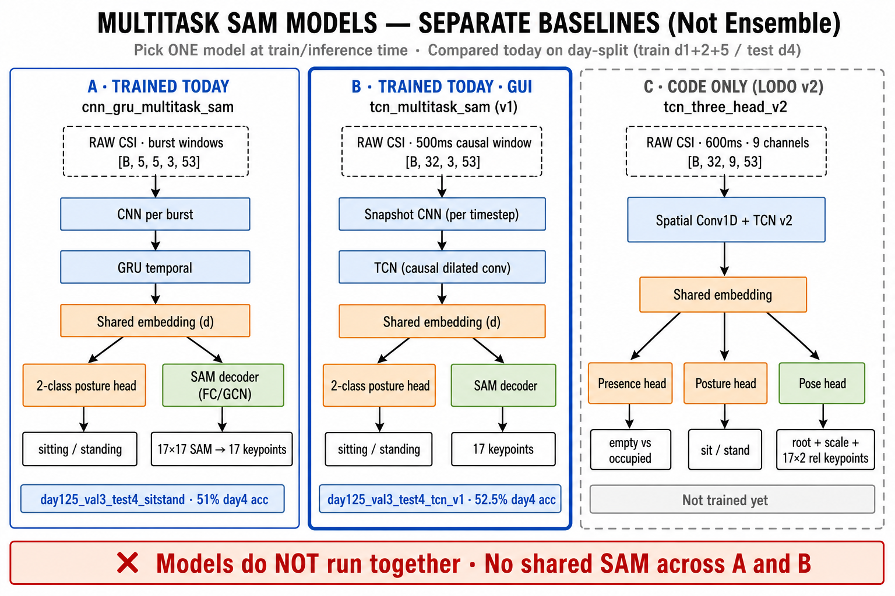

# Work Log — 28 August 2026

This document summarizes everything completed today on the WiFi CSI → human pose
project (`csi_pose_yolopose_pipeline`).

---

## 1. One-line summary

Today you moved from **in-domain person-ID splits** to a **hard cross-day stress test**
(train day1+2+5 / val day3 / test day4), analyzed **5-day CSI diversity**, trained and
evaluated **sit/stand-only** models (CNN+GRU baseline + **TCN** with 500 ms windows),
**implemented the LODO v2 protocol in code** (not yet trained), wired the **TCN into the
live GUI**, and documented why models fail on held-out days.



*Figure: Three separate model variants. A and B were trained/evaluated today as independent
baselines — only one checkpoint is loaded at inference (GUI uses TCN v1). C is LODO v2 code only.*

---

## 2. Literature & paper review (morning)

| Item | Status |
|------|--------|
| Evaluated `review papers.md` | Done — gaps noted (no cross-day column, no empty/presence row for pose papers) |
| Evaluated `review papers 2.md` | Done — stronger template; WiFlow link error noted |
| Identified **24-day** collection | **Harvesting Ambient RF** (presence / occupancy) |
| Identified **8-month** collection | **Wi-Pose** dataset paper |
| Deep review of **Harvesting Ambient RF** | Done — disjoint-day train/test, long human-free data, dedicated presence model |
| Synthesis with project docs | Reinforced: cross-day RF shift is the main blocker; presence/empty may need a separate head or protocol |

Related notes already in repo: `review papers.md`, `review papers 2.md`, `docs/WHY_MODEL_FAILS_AND_IMPROVEMENTS.md`.

---

## 3. Five-day CSI data analysis

### Completed

- Ran full **5-day diversity analysis** over **437 JSON sessions** (~985k CSI records).
- Ran **replicate separability** analysis (same session, `_2` / `_3` reps).

### Outputs

| File | Contents |
|------|----------|
| `outputs/qa/five_day_csi_diversity_analysis.json` | Per-day stats, cross-day Pearson/cosine by pose/distance/subject, worst pairs, current split similarity |
| `outputs/qa/replicate_separability_analysis.json` | Replicate stability, sit/stand separability by day, empty vs standing |

### Key findings

| Finding | Detail |
|---------|--------|
| **Strong day-specific RF** | Mean CSI fingerprints differ by day; train(test4) Pearson ~0.19 vs within-train ~0.35 |
| **Cross-day sit/stand** | Pearson mean ~0.25–0.27; some pairs **anti-correlated** (e.g. day3↔day4 ~−0.08) |
| **Replicates stable** | Same-session reps: Pearson mean **0.97** → capture noise is not the main failure mode |
| **Do not drop center/far** | Both distances needed for generalization |
| **Do not train far-only** | Does not fix cross-day drift |
| **Exclude one bad session** | `day5/004_standing_center_front.json` (~531 records, ~2.5 s CSI overlap) |
| **Malformed records** | ~168 bad records (0.017%) — already dropped by `csi_parser.is_valid_record()` |

---

## 4. New experiment protocol: day-split sit/stand only

### Design

| Setting | Value |
|---------|--------|
| Classes | **sitting**, **standing** only (empty excluded) |
| Split mode | `fixed_day` |
| Train | day1 + day2 + day5 |
| Val | day3 |
| Test | day4 (held-out RF domain) |
| Tag (GRU) | `day125_val3_test4_sitstand` |
| Tag (TCN) | `day125_val3_test4_tcn_v1` |
| Checkpoint metric | `val_classification_accuracy` (not total loss) |

### Code & config changes

- `src/config.py` — day split, `INCLUDE_EMPTY_ROOM_IN_DATASET=False`, 2-class head
- `src/dataset.py` — `fixed_day` split logic
- `src/evaluate.py` — bug fix for 2-class `has_pose` when `EMPTY_CLASS_INDEX=-1`
- `src/live/infer.py` — empty gating skipped when no empty class
- `tests/test_day_split_config.py`, `tests/test_fixed_split_config.py`
- `commands_sitstand_daysplit.txt`

### Backup

Previous 3-class day5 model saved under:

```text
backups/day5_id005_l1l2_20260828/
scripts/restore_backup.sh   # restores GUI + checkpoint
```

### Dataset (after rebuild)

| Split | Samples | Days |
|-------|---------|------|
| Train | 32,883 | day1, day2, day5 |
| Val | 11,122 | day3 |
| Test | 11,121 | day4 |
| **Total (GRU burst windows)** | **55,126** | sit/stand only |

TCN time-causal rebuild: **57,940** samples, shape `(57940, 32, 3, 53)`.

---

## 5. Model A — CNN+GRU baseline (`day125_val3_test4_sitstand`)

### Training

- 21 epochs; best val classification accuracy **49.5%** (epoch 17).
- Train acc → **~99.9%**; val day3 stuck ~**47–50%** (near chance).
- Saved best checkpoint: epoch **1** (early bug in selection before metric fix) — **not deployment-ready**.

### Test on day4 (offline eval)

| Metric | Value |
|--------|--------|
| Classification accuracy | **51.0%** |
| Normalized PCK@0.2 | **53.6%** |
| Pixel MPJPE | ~82 px |
| Sitting recall | **~25%** |
| Standing recall | **~77%** |

Outputs:

- `outputs/checkpoints/cnn_gru_multitask_sam_day125_val3_test4_sitstand_best.pt`
- `outputs/evaluation/cnn_gru_multitask_sam_day125_val3_test4_sitstand_metrics.json`
- `outputs/evaluation/cnn_gru_multitask_sam_day125_val3_test4_sitstand_test_metrics_by_pose.json`

**Verdict:** memorizes train days; **fails cross-day classification** on day4; collapses to **standing**.

---

## 6. Model B — TCN (`tcn_multitask_sam`, `day125_val3_test4_tcn_v1`)

### Implemented today

| Component | File / setting |
|-----------|----------------|
| TCN backbone + SAM heads | `src/models.py` → `tcn_multitask_sam` |
| 500 ms causal windows | `WINDOW_MODE=time_causal`, `TIME_WINDOW_SNAPSHOTS=32` |
| Live + offline pipeline | `src/time_windows.py`, `src/live/pipeline.py` |
| Parity check script | `scripts/compare_preprocess_parity.py` |
| Train / eval commands | `commands_tcn_daysplit.txt`, `docs/NEXT_STEPS.md` |

### Training

- **25 epochs** logged.
- Best val classification accuracy **53.6%** (epoch **24**).
- Eval JSON reports checkpoint **epoch 20** (metrics run before final epochs).

Checkpoints:

- `outputs/checkpoints/tcn_multitask_sam_day125_val3_test4_tcn_v1_best.pt`
- `outputs/csi_normalization_stats_day125_val3_test4_tcn_v1.npz`

### Test on day4 (offline eval, epoch 20 checkpoint)

| Metric | Overall | Sitting | Standing |
|--------|---------|---------|----------|
| Classification accuracy | **52.5%** | 24.9% | 80.1% |
| Normalized PCK@0.2 | **55.9%** | 29.4% | 82.4% |
| Pixel MPJPE | **81.9 px** | 97.6 px | 66.3 px |

Outputs:

- `outputs/evaluation/tcn_multitask_sam_day125_val3_test4_tcn_v1_metrics.json`
- `outputs/evaluation/tcn_multitask_sam_day125_val3_test4_tcn_v1_test_metrics_by_pose.json`
- `outputs/evaluation/tcn_multitask_sam_day125_val3_test4_tcn_v1_test_predictions.npz`
- `outputs/tcn_multitask_sam_day125_val3_test4_tcn_v1_training_history.json`

**Verdict:** TCN slightly improves PCK vs GRU on day4 but **same cross-day classification failure** — still predicts standing for most sitting windows.

---

## 7. LODO v2 pipeline (code complete — **not trained**)

Protocol documented in `docs/LODO_V2_PIPELINE.md` and `commands_lodo_v2.txt`.

### Goal

Use **Days 1–5** for development (LODO model selection → freeze → final train), then
**one-shot blind test** on a new capture day.

### Code added / updated

| File | Purpose |
|------|---------|
| `src/csi_features.py` | Log-amp, median-3, delta, rx-diff → **9 channels** |
| `src/models.py` | `TCNThreeHeadV2` — presence + posture + root-relative pose |
| `src/losses.py` | `ThreeHeadV2Loss` |
| `src/samplers.py` | `SessionBalancedSampler` |
| `src/build_dataset.py` | Session exclusion, 300 ms stride, label QC |
| `src/dataset.py` | `loso_day`, `final_all_days` splits |
| `src/train.py` | v2 loss, sampler, cosine LR |
| `scripts/run_lodo_experiment.py` | LODO runner (`amp9_med3` / `amp3_nomed`) |
| `tests/test_lodo_v2.py` | Basic tests |

### Defaults (v2 config in `src/config.py`)

- 600 ms windows, 9-channel CSI, median-3 filter
- 3-class: empty + sitting + standing
- Excludes `day5_004_standing_center_front`

**Status:** No `tcn_three_head_v2` checkpoints yet — **dataset build + LODO training not run**.

---

## 8. Live GUI & replay (TCN)

### Completed

| Item | Path |
|------|------|
| TCN GUI config overrides | `pose_detection_live/tcn_gui_overrides.json` |
| One-command launcher | `pose_detection_live/run_tcn_gui.sh` |
| TCN input shape in engine | `pose_detection_live/pose_engine.py` (32×3×53 windows) |
| Replay JSON eval script | `scripts/evaluate_replay_json.py` |

### Launch GUI with TCN

```bash
cd pose_detection_live
./run_tcn_gui.sh
```

### Fast replay test (CLI)

```bash
cd pose_detection_live
export CSI_CONFIG_OVERRIDES="$(pwd)/tcn_gui_overrides.json"
export PYTHONPATH=..
../.venv/bin/python3 run_live.py \
  --checkpoint ../outputs/checkpoints/tcn_multitask_sam_day125_val3_test4_tcn_v1_best.pt \
  --replay ../data/raw/csi/day4/005_sitting_center_front.json \
  --max-predictions 20
```

### Replay eval (partial, day4 ID 005)

Early replay evaluation (stride 10, ~76 windows/file) on `day4/005_*.json`:

| GT | Majority vote result |
|----|----------------------|
| All **sitting** files (6) | **MISS** — predicted **standing** |
| **Standing** files (2+ of 12 done) | **OK** — predicted **standing** |

Matches offline day4 confusion matrix (low sitting recall).

### Why GUI replay feels slow

- One JSON → **~760 windows** → inference on **every** window on CPU (~5–10 min/file).
- No progress bar; Tkinter main thread blocked.
- Use CLI with `--max-predictions 20` or `evaluate_replay_json.py --window-stride 10` for faster checks.

---

## 9. Bugs fixed today

| Issue | Fix |
|-------|-----|
| `evaluate.py` `has_pose` wrong for 2-class | Explicit check when `EMPTY_CLASS_INDEX=-1` |
| TCN forward shape | `return x[:, :, -1]` in temporal pooling |
| `train.py` scheduler | Cosine fallback after `LR_SCHEDULER_PATIENCE` removal |
| Replicate analysis script | `defaultdict` append bug |
| Dataset briefly empty-only | Rebuilt with TCN overrides |
| GUI model name mismatch | `CSI_CONFIG_OVERRIDES` + `run_tcn_gui.sh` |

---

## 10. Main conclusions from today

1. **Cross-day RF drift is real and severe** — day4 test is much harder than within-train days; a simple day classifier can separate days from CSI fingerprints alone.
2. **Changing backbone (GRU → TCN) does not fix it** without domain adaptation or better features/protocol.
3. **Sitting is the failure mode** on held-out day4 (~25% recall); model defaults to standing.
4. **Replicates are stable** — failures are domain shift, not capture noise.
5. **Do not deploy** `day125_val3_test4_*` models for live demo on unseen RF conditions.
6. **Next serious attempt** = **LODO v2** (9-channel features, 3-head model, presence/posture split, session-balanced training) — code ready, training pending.
7. **For live demo today** — restore in-domain 3-class model: `bash scripts/restore_backup.sh` (day5 `id005_l1l2`).

---

## 11. Not completed / stopped early

| Task | Status |
|------|--------|
| LODO v2 dataset build + training | Code only |
| Full replay eval JSON saved | Script written; full 12-file run interrupted |
| TCN GUI replay speedup (cap windows / progress bar) | Discussed, not patched |
| Brief training smoke test | Stopped by user (exit 143) |
| Re-eval TCN with epoch 24 best checkpoint | Metrics on disk still reference epoch 20 |

---

## 12. Quick command reference

```bash
# Project root
cd ~/Downloads/CSI/csi_pose_yolopose_full_pipeline/csi_pose_yolopose_pipeline
export PYTHONPATH=.

# TCN offline eval (with overrides)
CSI_CONFIG_OVERRIDES=pose_detection_live/tcn_gui_overrides.json \
  .venv/bin/python -m src.evaluate

# TCN GUI
pose_detection_live/run_tcn_gui.sh

# Restore previous 3-class demo model
bash scripts/restore_backup.sh

# LODO v2 (when ready)
.venv/bin/python -m src.build_dataset
.venv/bin/python scripts/run_lodo_experiment.py --variant amp9_med3

# Replay batch eval
CSI_CONFIG_OVERRIDES=pose_detection_live/tcn_gui_overrides.json \
  .venv/bin/python scripts/evaluate_replay_json.py \
  --glob 'data/raw/csi/day4/005_*.json' --window-stride 10
```

---

## 13. File index (today’s artifacts)

### Documentation

- `docs/WORK_LOG_2026-08-28.md` — this file
- `docs/NEXT_STEPS.md`
- `docs/LODO_V2_PIPELINE.md`
- `docs/WHY_MODEL_FAILS_AND_IMPROVEMENTS.md`

### Commands

- `commands_sitstand_daysplit.txt`
- `commands_tcn_daysplit.txt`
- `commands_lodo_v2.txt`

### QA / evaluation

- `outputs/qa/five_day_csi_diversity_analysis.json`
- `outputs/qa/replicate_separability_analysis.json`
- `outputs/evaluation/tcn_multitask_sam_day125_val3_test4_tcn_v1_*.json`
- `outputs/evaluation/cnn_gru_multitask_sam_day125_val3_test4_sitstand_*.json`

### Models

- `outputs/checkpoints/tcn_multitask_sam_day125_val3_test4_tcn_v1_best.pt`
- `outputs/checkpoints/cnn_gru_multitask_sam_day125_val3_test4_sitstand_best.pt`
- `backups/day5_id005_l1l2_20260828/`

### Live

- `pose_detection_live/run_tcn_gui.sh`
- `pose_detection_live/tcn_gui_overrides.json`
- `scripts/evaluate_replay_json.py`

---

*Last updated: 2026-08-28*
