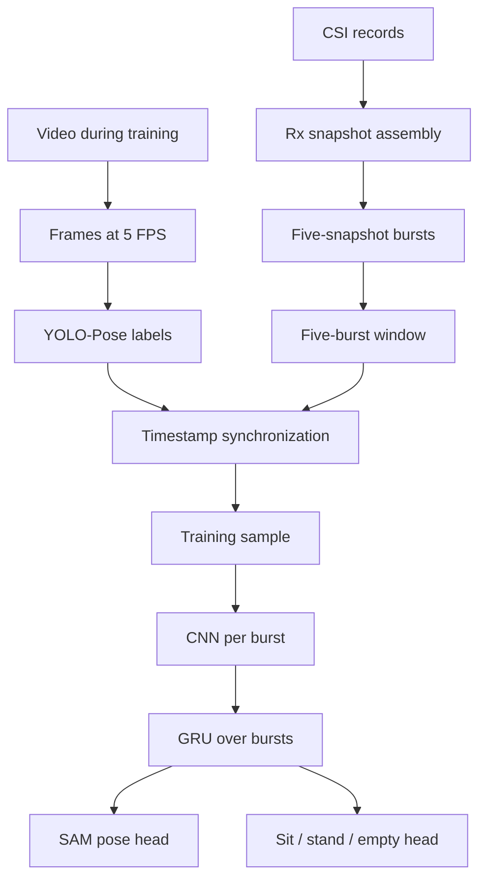

Bottom line: this is a credible research prototype with a sensible end-to-end pipeline. It is not yet a reliable live system because the most deployment-critical function, deciding whether anybody is present, fails on unseen RF conditions.

I reviewed the attached `src.zip`. The code passes a syntax compilation check, but the archive does not include the dataset, checkpoint, result files, or `pose_detection_live/`, so I could inspect the implementation but could not reproduce the reported metrics or verify the Banana Pi transport.

## 1) Project status summary

### Completed

* CSI parsing, validation, burst formation, and temporal-window construction.
* Video frame extraction and timestamp-based CSI–frame synchronization.
* YOLO-Pose teacher labeling.
* NPZ dataset construction with CSI, keypoints, SAM, confidence, classes, sessions, and subject metadata.
* Subject-independent non-empty split: ID 005 test, ID 006 validation.
* Session-level empty split, avoiding direct window-level leakage.
* CNN–GRU multitask student with pose regression and three-class classification.
* Empty samples correctly excluded from coordinate/SAM regression loss.
* Training-only CSI normalization with matching replay preprocessing.
* Replay inference, skeleton smoothing, and empty suppression.
* Per-pose evaluation that exposes the sitting/standing gap.

### Partially completed

* Empty detection works on familiar four-day conditions, including held-out sessions from those conditions.
* Live preprocessing is implemented carefully, but only replay is present in the supplied source.
* Domain robustness has been identified and documented, but not solved.
* Teacher confidence is used during training, but label-quality control and evaluation handling need improvement.

### Not completed

* Reliable empty detection under new RF conditions.
* Independent environment/day/location evaluation.
* Verified end-to-end physical Banana Pi streaming in the supplied code.
* Calibrated live decision thresholds and proper hysteresis.
* Session-level reliability metrics such as false-skeleton time per minute.
* Manual validation of YOLO labels, especially difficult sitting joints.
* A self-contained deployment bundle that locks preprocessing, normalization, class mapping, and checkpoint configuration.

So the honest status is:

> Research pipeline: complete.
> Offline proof of concept: strong.
> Reliable live demo: not yet complete.

## 2) Architecture explanation for a beginner

The stages exist for these reasons:

1. **Camera and YOLO teacher:** provide approximate joint locations during training. The student never needs the camera at deployment.

2. **CSI parsing:** removes invalid records, groups Rx0/Rx1/Rx2, and retains 53 usable subcarriers.

3. **Burst formation:** converts irregular raw packet records into fixed `[5 snapshots, 3 Rx, 53 subcarriers]` units.

4. **Temporal window:** combines five bursts so the model can use short-term RF evolution instead of one instantaneous CSI observation.

5. **Synchronization:** assigns each CSI window to the closest valid camera pose label.

6. **CNN:** learns spatial patterns across snapshots, receivers, and subcarriers for each burst.

7. **GRU:** summarizes how those features evolve across the five bursts.

8. **SAM head:** predicts a `[2,17,17]` pose representation. Diagonal entries contain absolute joint coordinates; off-diagonal entries represent joint-to-joint displacement.

9. **Classification head:** predicts sitting, standing, or empty.

10. **Live gate:** suppresses the skeleton when the empty prediction is sufficiently strong.

The implementation of these parts can be seen in [build_dataset.py](sandbox:/workspace/scratch/b4ba52d13cba/review_src/src/build_dataset.py), [models.py](sandbox:/workspace/scratch/b4ba52d13cba/review_src/src/models.py), and [live/pipeline.py](sandbox:/workspace/scratch/b4ba52d13cba/review_src/src/live/pipeline.py).

## 3) Strengths

* **Correct privacy boundary:** the camera is a training-time teacher, not an inference sensor.
* **Good split discipline:** person-ID separation is much stronger than randomly splitting overlapping CSI windows.
* **Empty is explicitly modeled:** treating empty as a real class is better than always drawing a skeleton.
* **Correct empty loss masking:** zero pose labels for empty samples do not pull the predicted skeleton toward `(0,0)`.
* **Reasonable model size:** CNN–GRU is appropriate for a small dataset and a live embedded demonstration.
* **Offline/live preprocessing alignment:** the same feature transformation and normalization logic is used in both paths.
* **Useful synchronization safeguards:** maximum timing error and maximum temporal-window span are enforced.
* **Per-pose reporting:** the 79% sitting result is visible rather than hidden by the stronger standing score.
* **You tested truly new empty captures:** this revealed the real limitation instead of stopping at a flattering test number.

Your 87.7% PCK@0.2 is promising within the present protocol. The 96.5% standing result suggests that the system is learning real pose-related structure, not merely class labels.

## 4) Gaps and risks

### A. Empty-room domain shift is the main blocker

The held-out empty sessions still come from the same four-day acquisition family. They likely share room geometry, hardware placement, channel conditions, furniture, and device state with training.

Therefore:

* 100% on training/familiar `000_empty` sessions is a pipeline sanity check.
* 100% on held-out sessions from the same environment is useful but limited.
* Failure on `011_empty_room` and `012_empty_room` is stronger evidence of deployment behavior.

Increasing the empty class weight to 20 solved an in-distribution classification problem. It cannot create coverage of RF conditions absent from training.

### B. The live empty probability is not calibrated

Training uses weighted cross-entropy with an empty weight of 20, while live inference uses a fixed `P(empty) > 0.5` threshold. Weighted training changes the meaning of the softmax probability, so 0.5 should not be assumed to be an appropriate operating threshold.

The current gate in [live/infer.py](sandbox:/workspace/scratch/b4ba52d13cba/review_src/src/live/infer.py) also combines:

* majority voting over hard class predictions, and
* immediate suppression from one probability threshold.

This is not true hysteresis, and it does not protect against systematic OOD misclassification.

### C. Sitting accuracy may be limited partly by label quality

Sitting creates:

* knee/ankle occlusion,
* greater variation in leg position,
* chair-dependent geometry,
* stronger perspective effects,
* less reliable YOLO lower-body labels.

Two code details matter:

* `MIN_CONFIDENCE_WEIGHT = 0.05` means even zero-confidence teacher joints still affect training.
* Current PCK and MPJPE calculations ignore teacher confidence and evaluate every joint equally.

That can both hurt training and make the reported sitting result difficult to interpret. Inspect [losses.py](sandbox:/workspace/scratch/b4ba52d13cba/review_src/src/losses.py) and [metrics.py](sandbox:/workspace/scratch/b4ba52d13cba/review_src/src/metrics.py).

### D. Teacher configuration is not consistently applied

The YOLO settings declared in `config.py`, including image size, device, confidence threshold, and minimum mean keypoint confidence, are not actually used by `annotate_pose.py`. Annotation calls the model with Ultralytics defaults.

This is a reproducibility problem. New annotations could differ after a library update or when run on another machine.

### E. Window-level metrics overstate effective sample size

Adjacent five-burst windows share four bursts. Therefore thousands of evaluated windows may represent only a small number of independent sessions.

For live reliability, report results by session and condition, not only by window:

* worst-session result,
* median across sessions,
* false-skeleton duration,
* longest continuous false detection.

### F. PCK@0.2 alone is too forgiving

The threshold is 20% of the teacher-pose bounding-box diagonal. It can be fairly large, and the diagonal itself is calculated using all joints, including unreliable teacher joints.

Also report:

* PCK@0.05, 0.10, and 0.20,
* normalized MPJPE,
* torso-normalized error,
* per-joint PCK,
* sitting lower-body PCK,
* temporal jitter.

### G. The SAM output is redundant

The active FC decoder predicts all 578 SAM values independently, while live reconstruction uses only the 34 diagonal coordinate values. Predicted off-diagonal displacements are not guaranteed to agree exactly with the diagonal coordinates.

SAM can remain as auxiliary supervision, but a direct 34-coordinate head with SAM reconstructed from those coordinates is a cleaner baseline. This is secondary to the data problem.

### H. The alternative empty-profile mode should not be enabled as-is

`empty_room_delta_db` currently requires exactly one empty capture and builds its profile before the train/validation/test split. With your multi-empty dataset it will fail, and with one capture it could introduce an evaluation-contamination risk.

A runtime, deployment-specific empty calibration is more defensible than this single static profile.

### I. Future data ingestion needs generalization

Day handling is hard-coded to `day1` through `day4`. A `day5` directory will not receive the same canonical session treatment. Replace this with a general `day\d+` parser before collecting more data.

## 5) Prioritized improvement plan

### Must

1. **Freeze the current new-empty captures as a domain test.**

   Do not immediately train on both `011` and `012`. Keep at least one untouched as the final deployment holdout.

2. **Collect paired data under deployment conditions.**

   For each equipment/environment state, collect:

   * empty,
   * sitting,
   * standing,
   * empty-to-occupied and occupied-to-empty transitions.

   Record these back-to-back without moving the hardware. Repeat after device reboot, on different days, and with realistic door/furniture/interference changes. This prevents the model from confusing session identity with occupancy.

3. **Add environment-level evaluation.**

   Maintain two independent evaluation axes:

   * unseen person in a familiar environment,
   * unseen session/day/environment.

   A reliable model must perform reasonably on both.

4. **Build a dedicated presence gate.**

   Use a binary `empty versus occupied` head, followed by a conditional sitting/standing head. Select its threshold using representative validation domains.

   For live operation:

   * show a skeleton only after several consecutive occupied decisions;
   * suppress it after several consecutive empty decisions;
   * use separate enter/exit thresholds;
   * add an `RF uncertain` state that also suppresses the skeleton.

5. **Measure deployment metrics.**

   Set release targets for:

   * false-skeleton seconds per empty minute,
   * longest false-skeleton episode,
   * occupied false-suppression rate,
   * presence detection latency,
   * worst-session sitting PCK,
   * live inference rate and dropped-burst rate.

6. **Fix annotation reproducibility.**

   Make `annotate_pose.py` use the declared model, image size, device, and confidence settings. Save the Ultralytics version and teacher checkpoint hash with the labels.

7. **Verify physical live parity.**

   Feed one recorded CSI file through:

   * offline preprocessing,
   * replay preprocessing,
   * Banana Pi preprocessing.

   Compare every emitted window and logit numerically. Then run at least 10–15 minutes of continuous empty testing per deployment condition.

### Should

* Manually inspect or correct 100–200 held-out sitting frames, focusing on hips, knees, and ankles.
* Mask extremely low-confidence teacher joints instead of forcing a minimum 0.05 weight.
* Use session-balanced sampling so long or highly overlapping captures do not dominate training.
* Compare class weight 20 against milder weighting plus balanced sampling.
* Select checkpoints using a deployment-aligned score rather than total validation loss alone.
* Save preprocessing parameters, label mapping, normalization statistics, model configuration, and checkpoint together as one deployment bundle.
* Add packet-quality, invalid-record, burst-drop, and window-gap telemetry to the live UI.
* Generalize day/session parsing before further collection.

### Nice to have

* Direct coordinate prediction with SAM reconstructed as an auxiliary target.
* Log-amplitude or temporal-difference features.
* Runtime empty-room calibration when the demo can start with 20–30 seconds of confirmed emptiness.
* Sanitized CSI phase after amplitude experiments are exhausted.
* Domain-adversarial training after you have several genuinely distinct environments.
* Quantization or architectural compression only if Banana Pi latency requires it.

## 6) Suggested experiments

| Area              | Experiment                                                         | Main metric                                       | What would justify keeping it                              |
| ----------------- | ------------------------------------------------------------------ | ------------------------------------------------- | ---------------------------------------------------------- |
| Data              | Add paired empty/sit/stand sessions from the new RF condition      | Worst-session false-skeleton time and sitting PCK | Large gain on untouched new-domain sessions                |
| Split             | Leave one complete day/environment out                             | Worst-domain empty recall and occupied recall     | Performance remains stable across held-out domains         |
| Presence          | Three-class head versus binary presence plus conditional pose head | Presence PR-AUC, empty false alarms/min           | Lower empty false alarms without suppressing people        |
| Calibration       | Sweep threshold, probability EMA, and hysteresis durations         | False-skeleton seconds/min and transition delay   | Meets reliability target with acceptable delay             |
| Sampling          | Window-balanced versus session-balanced batches                    | Worst-session metrics                             | Reduced variance and fewer session-specific failures       |
| Class loss        | Empty weight 20 versus 2/5/10 and balanced sampling                | ECE/Brier score, empty FPR, occupied recall       | Better calibrated gate without loss of recall              |
| Teacher loss      | Current 0.05 floor versus confidence threshold or `confidence²`    | Manually checked sitting PCK and lower-body MPJPE | Better sitting joints on audited labels                    |
| Representation    | Current FC-SAM versus 34-coordinate head with derived SAM          | Sitting PCK@0.1/0.2 and SAM consistency           | Equal or better accuracy with less output redundancy       |
| Input             | Normalized amplitude versus log-amplitude and temporal differences | Cross-domain empty FPR and sitting PCK            | Improves new-domain results, not only familiar data        |
| Calibration input | No deployment calibration versus 30-second empty reference         | Cross-day false alarms                            | Consistent improvement across several deployment sessions  |
| Window            | 3, 5, and 9 bursts                                                 | PCK, class F1, transition latency                 | Best reliability–latency tradeoff                          |
| Live parity       | Offline versus replay versus hardware stream                       | Maximum input/logit difference                    | Numerically identical within floating-point tolerance      |
| Sequence          | Static-window versus continuous episode evaluation                 | Longest error episode and skeleton jitter         | Demonstrates stable visual behavior, not isolated accuracy |

Do not use `011` and `012` repeatedly for architecture and threshold selection and then call them test data. Use one for development and preserve the other, or collect a third untouched condition.

## 7) Questions to answer before changing the model

1. Were transmitter, receiver, antennas, furniture, and subject zone identical across all four days?
2. What changed between the familiar empties and `011/012`: hardware reboot, antenna angle, channel, furniture, doors, nearby people, or device placement?
3. Are WiFi channel, bandwidth, transmit power, packet rate, and firmware fixed?
4. Are RSSI, SNR, packet loss, valid-snapshot rate, burst size, and burst rate different in the failed captures?
5. Can every live demonstration begin with a confirmed 20–30-second empty calibration?
6. Are sitting and standing recorded in every environment where empty is recorded?
7. How many chairs, sitting styles, orientations, distances, and subject positions are included?
8. Do pose sessions contain transitions even though the entire session has one sitting/standing label?
9. Are the camera and CSI timestamps generated from the same clock? What are median, 95th-percentile, and maximum synchronization errors?
10. Has anyone manually inspected difficult YOLO sitting labels?
11. Can another person, reflection, or movement outside the intended sensing zone affect CSI?
12. Is the intended live scope one person in one fixed room, or must the model survive hardware relocation?
13. What error is worse for the demo: a false skeleton in an empty room or briefly hiding a real person?
14. Does the Banana Pi use exactly the same checkpoint, normalization statistics, subcarrier indices, and burst timing constants?
15. What continuous duration must the demo operate without a false empty-room skeleton?

## 8) What not to waste time on

* A larger Transformer, deeper CNN, or complicated GCN before fixing domain coverage.
* Increasing the empty class weight beyond 20.
* Tuning repeatedly against `011/012` and then presenting them as unseen tests.
* Adding more overlapping windows from the same captures and treating them as new data.
* Using stronger temporal smoothing to hide systematic OOD errors.
* Reporting only overall accuracy or PCK@0.2.
* Enabling the current single-profile `empty_room_delta_db` mode without redesigning its calibration and split handling.
* Adding raw phase directly without phase sanitization and hardware calibration.
* Optimizing inference speed before measuring the actual Banana Pi bottleneck.
* Chasing a one- or two-point offline PCK gain while new empty rooms still generate persistent false skeletons.

The highest-value next move is not another architecture. It is a small, carefully controlled paired collection across new RF conditions, followed by a calibrated binary presence gate and continuous session-level evaluation.
